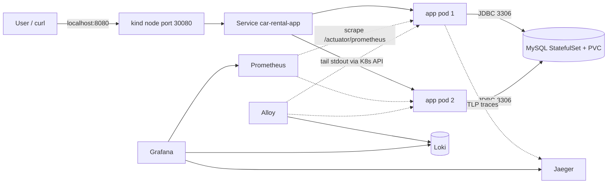
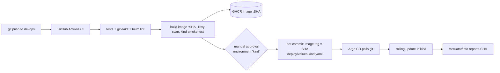

# Architecture

## Components

| Component | Runs as | Purpose |
|---|---|---|
| `car-rental-app` | Deployment, 2 replicas | Spring Boot REST API (stateless) |
| `car-rental-mysql` | StatefulSet, 1 replica + 2Gi PVC | MySQL 8.4, the only stateful part |
| Argo CD | `argocd` namespace | Keeps the cluster equal to git (`helm/car-rental` + `deploy/values-kind.yaml`) |
| Prometheus, Alertmanager, Grafana | `monitoring` namespace | Metrics, SLO alerts, dashboard |
| Jaeger v2 | `monitoring` namespace | Receives OTLP traces, trace UI |
| Loki (single binary) + Grafana Alloy | `monitoring` namespace | Alloy tails every pod's stdout via the Kubernetes API and ships it to Loki. App lines get a `level` label and `trace_id`/`span_id` metadata |

## Request path

- The Service only sends traffic to **ready** pods. Readiness includes a DB check, so if MySQL is down the pods drop out of the Service instead of returning errors, and liveness does not restart them (a restart would not fix the DB).
- NetworkPolicies: all ingress in `car-rental` is denied by default. App pods accept port 8080. MySQL accepts 3306 **only from app pods**.

## From commit to running pod

## Failure boundaries

| Failure | What happens | Signal |
|---|---|---|
| One app pod dies | The other replica serves; Deployment replaces the pod | `CarRentalDegraded` |
| MySQL pod dies | App pods go not-ready (no traffic), recover automatically when MySQL is back; data stays on the PVC | `CarRentalDatabaseDown`, `CarRentalNoReadyPods` |
| Bad image released | Readiness fails → rolling update stops (`maxUnavailable: 0` keeps old pods serving) | Argo CD `Progressing`/`Degraded` |
| Bad but "healthy" release (5xx) | Users see errors | `CarRentalHighErrorRate` → `git revert` the deploy commit |
| Someone edits the cluster by hand | Argo CD self-heal reverts it | Argo CD sync history |
| Node lost | Replicas are spread across 2 workers; PDB keeps ≥1 during drains | `CarRentalDegraded` |

Single points of failure that remain (accepted for a laptop project): one MySQL replica, single-node control plane, in-memory Jaeger storage.
